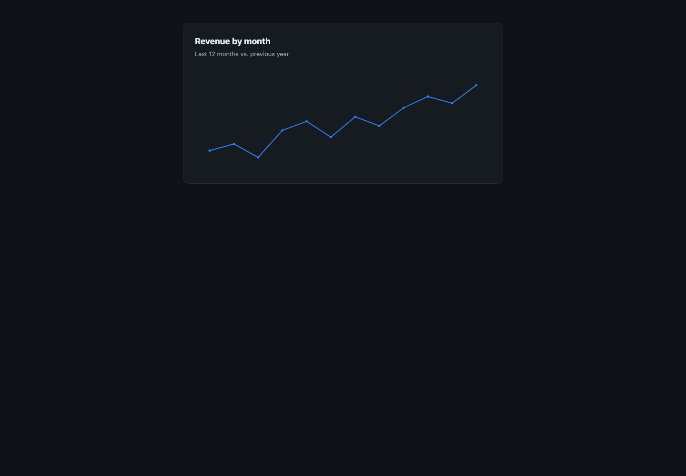

# har-replay-lab

把一个**已经登录的 Web 应用**录下来，在本地还原成能跑的前端，接口用录到的真实响应重放。
用来研究一个产品的**功能设计、页面状态机、交互流程**——而不是去偷它的源码。

> 你拿到的永远是「浏览器实际执行的那份代码」（压缩产物），不是作者写的那份。
> 这个工具不改变这个事实，它只是让那份产物能在本地跑起来、能点、能看。



---

## 它解决什么

想研究一个线上产品的前端，通常有三条路：

| 做法 | 问题 |
|---|---|
| 右键「另存为」/ Save All Resources | 只存了静态文件，接口全 404，页面白屏或卡在登录 |
| 硬啃压缩后的 JS | 能读逻辑，但看不到「页面怎么长出来的」 |
| **录 HAR + 本地重放** | 静态资源和真实接口响应一次拿全，页面能真的跑起来 |

关键的认知是：**HAR 里不只有接口，还有 HTML/CSS/JS 的原始响应体**。
把它们还原成目录结构，再让接口返回录到的响应，整个应用就能在本地活过来。

---

## 快速开始

### 0. 准备一个可接管的 Chrome

Chrome 136+ 不允许用默认 profile 开调试端口，所以要一个独立 profile：

```bash
# macOS
"/Applications/Google Chrome.app/Contents/MacOS/Google Chrome" \
  --remote-debugging-port=9222 --user-data-dir=/tmp/chrome-replay
```

```bash
# Linux
google-chrome --remote-debugging-port=9222 --user-data-dir=/tmp/chrome-replay
```

这个 profile 是空的，第一次要在里面**登录一次**目标站点。

### 1. 录制

```bash
node scripts/capture.mjs --url https://example.com/app
```

窗口里把每个页面、每个 tab 都点一遍，走一次完整的核心流程，然后回终端按回车。

> 也可以完全跳过这一步：在 DevTools 的 Network 面板里手动 `Export HAR`（过滤器要停在 **All**），
> 效果一样。脚本的好处是不用手点菜单，而且不用记「导出会滤掉被过滤的请求」这个坑。

### 2. 还原静态站点

```bash
node scripts/to-site.mjs captures/capture-xxx.har
```

输出到 `site/`，同时打印体检报告：识别到的框架、**有没有 source map**、抓到了哪些接口。

### 3. 生成 mock 数据

```bash
node scripts/to-fixtures.mjs captures/capture-xxx.har
```

输出到 `fixtures/`。同一端点被调用多次会按顺序存成 `__1 __2 __3`。

### 4. 跑起来

```bash
node scripts/serve.mjs
# → http://127.0.0.1:8787
```

打开你录的那个路由，浏览器里点。没 mock 到的请求会打到终端并记进 `logs/misses.jsonl`。

### 5. 验证（可选但强烈建议）

```bash
node scripts/walk.mjs --base http://127.0.0.1:8787 --path /app
```

自动登录、提问、按优先级点按钮，最后判定**有没有出图**。出图说明 mock 覆盖到结果页了。

---

## 先看演示

不想碰真实站点的话，仓库里带了一个合成的 demo 应用：

```bash
# 终端 A
node examples/demo-app.mjs            # http://127.0.0.1:8890

# 终端 B：录它
node scripts/capture.mjs --port 9222 --url http://127.0.0.1:8890/login --wait 30
# （30 秒内去窗口里登录、提问、点两个选项、点 Run）

# 或者直接用已经录好的 examples/demo.har
node scripts/to-site.mjs examples/demo.har
node scripts/to-fixtures.mjs examples/demo.har
node scripts/serve.mjs --port 8788
```

---

## 命令

| 命令 | 作用 |
|---|---|
| `capture.mjs --url <地址>` | 通过 CDP 录 HAR（`--wait N` 无人值守，`--out` 指定文件） |
| `to-site.mjs <har>` | HAR → `site/`，带体检报告（`--origin` 强制指定源站） |
| `to-fixtures.mjs <har>` | HAR → `fixtures/`，多轮调用按序回放（`--only /api/` 过滤路径） |
| `serve.mjs` | 托管 `site/` + 重放 `fixtures/`（`--port`、`--site`、`--fixtures`） |
| `walk.mjs` | 自动走流程验证出图（`--base`、`--path`、`--question`、`--steps`） |

自检端点：`GET /__mock/status` 返回已服务数、mock 命中数、序列游标、日志路径。

---

## 它是怎么工作的

```
HAR
 ├─ 同源 GET 200 的 html/js/css/字体/图片 ──→ site/        （to-site）
 └─ /api/* 的 JSON / NDJSON 响应          ──→ fixtures/    （to-fixtures）
                                                │
serve.mjs ── 静态命中就返回文件 ────────────────┘
         └─ 否则按 路径 → fixtures 匹配，返回录到的响应
```

**匹配是三级降级**：

1. 路径完全一致
2. 把动态段（会话 id 之类）归一成 `:id` 再比
3. 只比路径末两段（跨会话兜底）

**请求体不参与匹配** —— 所以选项选哪个、表单填什么，都会落到同一份录制上。

**同一端点录了多次 → 按序回放**，用完之后停在最后一个（多点几下也还有响应）。

---

## 已知边界

这套东西是「录像重放」，不是「逻辑模拟」，所以：

| 情况 | 表现 | 说明 |
|---|---|---|
| 走了录制时没走过的分支 | 该接口 404，流程停住 | 只能回原站补录那一条分支 |
| 换一个问题 / 换一份数据 | 界面仍显示录制时的内容 | 前端不自己理解语义，全部听服务端的 |
| 流式响应（NDJSON/SSE） | 一次性全渲染，没有逐段推进 | 看内容可以，看流式交互不行 |
| 需要后端计算的东西 | 拿不到 | 真正的业务逻辑在服务端，这里只有结果 |

**最值得记住的一条**：不要拿另一个会话的响应去补当前会话的缺口。
状态是服务端驱动的，拼两段录像会造出一个不存在的状态，界面直接错乱。
宁可 404，也不要假数据。

---

## 排错

| 现象 | 原因 | 处理 |
|---|---|---|
| 页面全白，`/__mock/status` 里 served=0 | HAR 里没有 HTML | Network 过滤器要停在 **All**，勾 Disable cache 后刷新再导出 |
| 卡在登录页 | 缺 `/api/auth/login` | 从原站登录一次再录；或手动 `curl` 一下接口补 fixture |
| `Unexpected non-whitespace character after JSON at position N` | NDJSON 被当成普通 JSON 发回 | 保留原始 `content-type`，别美化 NDJSON |
| 点按钮没反应 | 缺那个动作对应的接口 | 看 `logs/misses.jsonl`，回原站补录 |
| 明明有图却报「没出图」 | 图表是 Plotly/ECharts，不是 canvas | `walk.mjs` 已覆盖常见图表库，自定义的可改判定 |
| `sourceMappingURL` 指向的 map 没抓到 | 浏览器只在 DevTools 打开时才请求 map | 开着 DevTools 录一次，或按 URL 单独下载 |

---

## 合规

这个工具只做一件事：把**你自己有权访问的页面**在本地重放。

- ✅ 个人学习、研究交互设计、做技术选型参考
- ✅ 分析自己公司的系统、有授权的项目
- ❌ 把还原出来的产物部署到公网、分发、商用
- ❌ 绕过任何认证、付费墙、访问控制
- ❌ 规避版权保护

还原出来的页面里通常还带着原站的 logo、文案和版权声明，**它们仍然属于原作者**。
别把 `site/` 当自己的作品发布。

另外：HAR 里可能含 `Cookie` / `Authorization` 头。用 DevTools 的
"Export HAR (sanitized)" 可以去掉它们；用本工具录的 HAR 是**完整的**，别外传。

---

## 环境

- Node ≥ 22（用了内置的 `WebSocket` 和 `fetch`）
- Chrome / Chromium
- 零第三方依赖，不需要 `npm install`

## License

MIT
